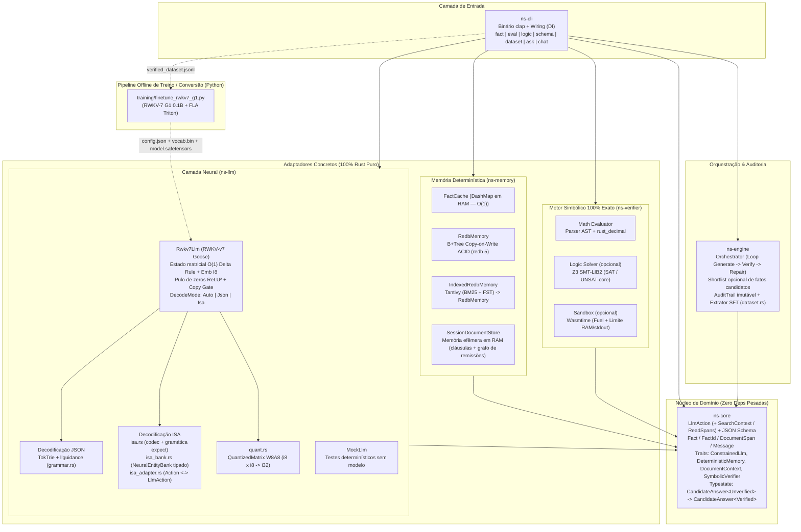
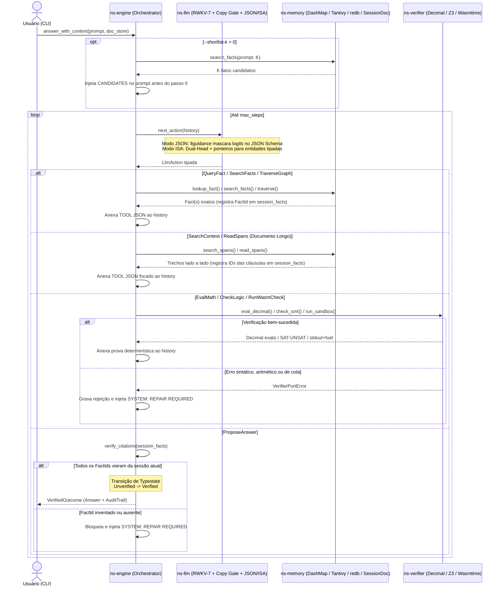
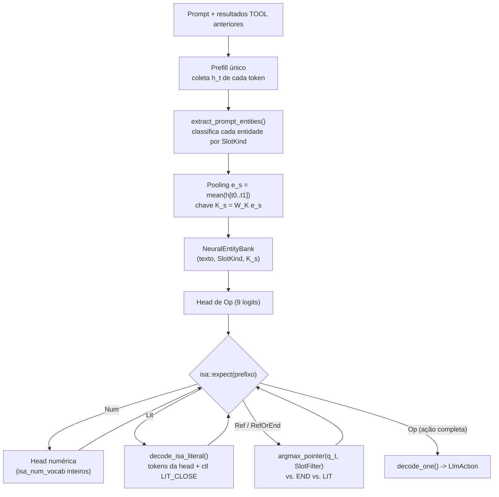
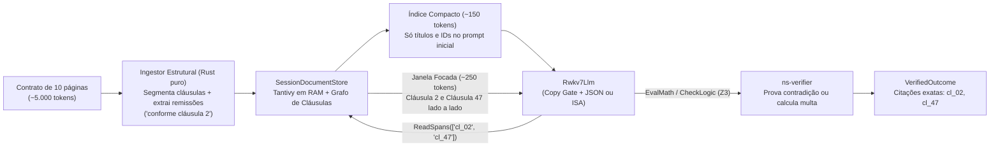

# NeuralSym

Motor **neuro-simbólico 100% Rust puro** (focado em CPU e Linux embarcado) que separa a interpretação de linguagem natural (modelo neural RWKV-7 nativo) da verdade factual (memória determinística `redb` + `Tantivy`) e da verificação formal (matemática decimal exata, provas lógicas SMT e execução isolada em WebAssembly).

O sistema elimina dependências de C++/CUDA em tempo de inferência e dispensa o KV-Cache crescente dos Transformers tradicionais. O motor neural é próprio, escrito em Rust (`unsafe_code = "forbid"`):

- **RWKV-v7 ("Goose"):** estado matricial $O(1)$ com Regra Delta Generalizada (zero KV-Cache), *Value Residual*, pulo físico de colunas zeradas pelo `ReLU²`, embeddings `int8`, **Pointer/Copy Gate ($d_c = 64$)** e importação/pós-treino direto do checkpoint aberto **`RWKV-7 G1 0.1B`** (191M parâmetros, Apache-2.0, >5T tokens incluindo PT-BR).
- **Dois modos de decodificação de ações**, escolhidos por `--mode auto|json|isa`:
  - **JSON + `llguidance`:** o autômato do JSON Schema de `LlmAction` mascara os logits.
  - **ISA (Dual-Head + Entity Pointer):** o modelo não emite JSON; emite uma sequência curta de símbolos (`Op`, `Ptr`, `Lit`, `Num`, `End`). Entidades (IDs de fatos, cláusulas, termos do prompt) são endereçadas por **ponteiro neural** em 1 passo de decode, e a origem de cada entidade é tipada, de modo que **citar um ID inventado é irrepresentável** em modo estrito.

---

## 1. Arquitetura do Sistema

### 1.1 Workspace de Crates e Inversão de Dependência (Ports & Adapters)



### 1.2 Fluxo de Execução (Generate → Verify → Repair)



### 1.3 Decodificação ISA (Dual-Head + Entity Pointer)

Em vez de gerar ~60 tokens de JSON por ação, o modelo gera de 3 a 6 símbolos. O Rust converte de/para o JSON canônico (`isa.rs` + `isa_adapter.rs`), então o restante do sistema continua falando `LlmAction`.

| Operação ISA | Forma dos argumentos | `LlmAction` |
|---|---|---|
| `QUERY` | `Ref Ref` | `QueryFact` |
| `SEARCH` | `Ref Num` | `SearchFacts` |
| `TRAVERSE` | `Ref Num` | `TraverseGraph` |
| `EVAL` | `Lit` | `EvalMath` |
| `ANSWER` | `Lit RefList` | `ProposeAnswer` |
| `SEARCH_CTX` | `Ref Num` | `SearchContext` |
| `READ` | `RefList` | `ReadSpans` |
| `LOGIC` | `Lit` | `CheckLogic` |
| `WASM` | `Lit Lit` | `RunWasmCheck` |

Exemplo: `ReadSpans(["cl_02", "cl_47"])` vira `<READ> #0 #1 <END>` (4 passos de decode, contra 15 ou mais tokens do JSON equivalente).



**Entidades tipadas (`SlotKind`).** Cada slot do banco carrega a origem da entidade, e a posição da gramática decide quais origens ficam visíveis ao ponteiro (`SlotFilter`):

| `SlotKind` | Origem | Citável (`ANSWER`) | Legível (`READ`) |
|---|---|:-:|:-:|
| `PromptEntity` | Palavras do `USER:` e campos `subject`/`relation`/`object` | não | não |
| `DocumentToc` | Índice compacto `[cl_02] ...` | não | sim |
| `ReadSpan` | Cláusula já lida via `ReadSpans` (`TOOL: {"spans": ...}`) | sim | sim |
| `VerifiedFact` | Fato retornado por ferramenta (`TOOL: {"fact": ...}`) | sim | não |
| `CandidateFact` | Fato pré-injetado pela shortlist (`CANDIDATES: [...]`) | sim | não |

Com `strict_citations = true`, nas posições de referência só existem ponteiros válidos: um `FactId` inventado, uma entidade só mencionada no prompt ou uma cláusula que não foi lida simplesmente não têm logit. Uma entidade promovida (ex.: `DocumentToc` → `ReadSpan` depois do `READ`) passa a ser citável.

**Propriedades do codec** (cobertas por testes de propriedade em `isa.rs`):

1. `decode(encode(a, bank), bank) == a` para qualquer ação e qualquer banco (o fallback `Lit` torna o codec sem perdas mesmo sem ponteiros).
2. Passar por texto (`to_text` / `from_text`) também é sem perdas.
3. Ter um banco nunca aumenta o custo.
4. `expect()` (a gramática/máscara) nunca proíbe a continuação verdadeira.
5. Nenhuma entrada arbitrária causa `panic`.

**Ativação.** O checkpoint declara `isa_ptr_dim` e `isa_num_vocab` no `config.json`. Com `isa_ptr_dim = 0` o modelo usa apenas JSON + `llguidance`; com `isa_ptr_dim > 0` (ex.: `64`) a Dual-Head ISA é carregada.

### 1.4 Ciclo de Self-Play Verificado e Documentos Longos (Context-as-Memory)




---

## 2. Fórmulas Matemáticas Utilizadas

### 2.1 Confiabilidade Composta (Motivação Neuro-Simbólica)

Em um modelo puramente probabilístico com taxa de acerto $p \in (0,1)$ por passo lógico ou aritmético, a confiabilidade de uma cadeia de $n$ passos decai exponencialmente:

$$P_{\text{puro}}(n) = p^{\,n}$$

Ao delegar consultas factuais ao `ns-memory` e provas/cálculos ao `ns-verifier` ($p_{\text{simbólico}} = 1$), o erro deixa de se acumular nas etapas exatas e fica restrito à tradução de intenção ($k \ll n$ turnos), protegida por até $R$ ciclos de reparo determinístico.

### 2.2 Recorrência RWKV-v7 ("Goose") — Estado Matricial O(1) com Regra Delta Generalizada

Sem KV-Cache: cada camada $\ell$ e cabeça $h \in \{0, \dots, H-1\}$ mantém uma matriz associativa fixa $S_t \in \mathbb{R}^{N \times N}$ ($N = 64$, residente em cache L1) que apaga seletivamente valores antigos sob uma chave normalizada $\tilde{k}_t$ antes de gravar o novo par $(v_t, \hat{k}_t)$:

$$w_t = \exp\!\Big(-e^{-0.5}\,\sigma\big(w_0 + \tanh(x^{(w)}_t W_{w1}) W_{w2}\big)\Big), \qquad a_t = \sigma\big(a_0 + (x^{(a)}_t W_{a1}) W_{a2}\big)$$

$$\tilde{k}_t = \frac{k_t \odot k_k}{\max(\Vert{}k_t \odot k_k\Vert{}_2,\; 10^{-12})}, \qquad \hat{k}_t = k_t \odot \big(1 + (a_t - 1) \odot k_a\big)$$

$$S_t = S_{t-1}\big(\operatorname{diag}(w_t) - \tilde{k}_t (a_t \odot \tilde{k}_t)^\top\big) + v_t \hat{k}_t^\top$$

$$y_t = \operatorname{GroupNorm}_H(S_t\, r_t) + \Big(\sum_{n=0}^{N-1} r_{t,n}\, \hat{k}_{t,n}\, r_{k,n}\Big)\, v_t, \qquad y^{\text{tm}}_t = W_o\, (y_t \odot g_t)$$

Nas camadas $\ell > 0$, o *Value Residual* mistura o valor da camada 0 ($v^{(0)}_t$) por uma porta aprendível:

$$v_t \leftarrow v_t + \big(v^{(0)}_t - v_t\big) \odot \sigma\big(\nu_0 + (x^{(v)}_t W_{v1}) W_{v2}\big)$$

### 2.3 Channel-Mixing RWKV-v7 com Pulo Físico de Zeros (ReLU² Esparso)

$$a^{\text{cm}}_t = \big(\max(0,\; W'_k\, x^{(k')}_t)\big)^2, \qquad y^{\text{cm}}_t = \sum_{\substack{j=0 \\ a^{\text{cm}}_{t,j} > 0}}^{d_{\text{ffn}}-1} a^{\text{cm}}_{t,j}\, W'_{v, :, j}$$

Armazenando $W'_v$ em layout *column-major* (`SparseColQuantizedMatrix`), todas as colunas onde $a^{\text{cm}}_{t,j} = 0$ (~85–90% dos neurônios) não são sequer lidas da RAM.

### 2.4 Pointer / Copy Gate ($d_c = 64$) para Cópia Literal de IDs e Números

Sobre os últimos $M \le 512$ estados do prompt $(K_j, y_j)$, o decodificador calcula atenção de cópia e uma porta escalar $p_{\text{copy}} \in (0,1)$:

$$\alpha_j = \operatorname{softmax}_j\!\left(\frac{q_t^\top K_j}{\sqrt{d_c}}\right), \qquad c_t = \sum_{j=1}^{M} \alpha_j K_j, \qquad p_{\text{copy}} = \sigma\big(w_g^\top [h_t \,;\, c_t] + b_g\big)$$

$$P_{\text{final}}(v) = (1 - p_{\text{copy}})\, P_{\text{vocab}}(v) + p_{\text{copy}} \sum_{j:\, y_j = v} \alpha_j$$

### 2.5 Quantização Simétrica por Linha W8A8 (int8 × int8 → i32)

Para cada linha $W_i \in \mathbb{R}^K$ e vetor de ativação $x \in \mathbb{R}^K$:

$$s_i = \frac{\max_{0 \le j < K} \vert{}W_{i,j}\vert{}}{127}, \qquad Q_{i,j} = \operatorname{clamp}\!\left(\operatorname{round}\!\left(\frac{W_{i,j}}{s_i}\right),\, -127,\, 127\right)$$

$$\hat{y}_i = (s_i \cdot s_x) \sum_{j=0}^{K-1} \operatorname{i32}(Q_{i,j}) \cdot \operatorname{i32}(q_{x,j})$$

Garantia de não-overflow em 32 bits: como $\vert{}Q_{i,j} \cdot q_{x,j}\vert{} \le 127^2 = 16\,129$, para qualquer $K \le 131\,072$ (`MAX_QUANT_IN_DIM`) vale $16\,129 \cdot K \le 2\,114\,060\,288 \le 2^{31}-1$.

### 2.6 Constrained Decoding Esparso (llguidance) e Ranqueamento BM25 (Tantivy)

O autômato Earley do JSON Schema restringe a projeção da head apenas aos tokens permitidos $\mathcal{V}_t \subseteq \{0, \dots, V-1\}$ e pula a head em *fast-forward tokens* (`QuantizedMatrix::argmax_masked`). Na busca em `IndexedRedbMemory` e `SessionDocumentStore`, o Tantivy ranqueia candidatos com BM25 antes de ler os fatos no `redb`:

$$\text{BM25}(D, Q) = \sum_{q \in Q} \text{IDF}(q) \cdot \frac{f(q, D) \cdot (k_1 + 1)}{f(q, D) + k_1 \cdot \left(1 - b + b \cdot \frac{\vert{}D\vert{}}{\text{avgdl}}\right)}$$

### 2.7 Ponteiro de Entidade da ISA e Custo de Decode

Para cada entidade $s$ do prompt, ocupando os tokens $[t_0, t_1)$, a chave do ponteiro vem do *pooling* dos estados ocultos do prefill. Em cada posição de referência, a query vem do estado atual e o slot é o de maior score entre os permitidos pelo filtro $\mathcal{F}$ da gramática:

$$e_s = \frac{1}{t_1 - t_0} \sum_{t=t_0}^{t_1 - 1} h_t, \qquad K_s = W_K\, e_s, \qquad q_t = W_Q\, h_t$$

$$\hat{s} = \operatorname*{arg\,max}_{s \,\in\, \mathcal{F}(\text{op},\, \text{kind})} \frac{q_t^\top K_s}{\sqrt{d_p}}, \qquad d_p = \texttt{isa\_ptr\_dim}$$

O símbolo emitido é o de maior score entre o melhor ponteiro, `END` (só em `RefOrEnd`) e `LIT_OPEN` (só quando o literal é permitido; em modo estrito ele é proibido nas posições de citação).

O custo de uma ação, em passos de decode, é a soma dos custos de cada símbolo:

$$\text{custo}(\sigma_1 \dots \sigma_m) = \sum_{i=1}^{m} c(\sigma_i), \qquad c(\sigma) = \begin{cases} \lvert \text{tokens}(\text{texto}) \rvert + 1 & \sigma = \texttt{Lit}(\text{texto}) \\ 1 & \text{caso contrário (Op, Ptr, Num, End)} \end{cases}$$

---

## 3. Estrutura do Workspace e Features

```text
neurosym/
├── Cargo.toml                           # Virtual workspace (edition 2024, MSRV 1.95)
├── README.md
├── artifacts/                           # Datasets, checkpoints e bancos gerados (não versionado)
├── training/
│   ├── finetune_rwkv7_g1.py             # Conversor + SFT RWKV-7 G1 0.1B (Copy Gate + W8/Emb I8 + FLA)
│   └── rwkv7_block.py                   # Bloco RWKV-7 modular para PyTorch / Triton
└── crates/
    ├── ns-core/                         # LlmAction, Fact, DocumentSpan, traits (ports), erros tipados, typestate
    │   └── src/                         # action, error, fact, ports, verification
    ├── ns-memory/                       # RedbMemory (redb 5), IndexedRedbMemory (Tantivy), SessionDocumentStore
    │   ├── src/                         # facts, graph, search, store, session_doc.rs
    │   └── benches/                     # storage_comparison.rs
    ├── ns-llm/                          # Motor neural nativo
    │   ├── src/
    │   │   ├── rwkv7.rs                 # Rwkv7Llm, DecodeMode, estado O(1), Copy Gate, chat contínuo
    │   │   ├── quant.rs                 # QuantizedMatrix W8A8 (matvec, argmax mascarado/esparso)
    │   │   ├── grammar.rs               # JSON Schema de LlmAction para o llguidance
    │   │   ├── isa.rs                   # Codec Action <-> ISA + gramática expect() (só std)
    │   │   ├── isa_bank.rs              # NeuralEntityBank, SlotKind, SlotFilter, extração de entidades
    │   │   ├── isa_adapter.rs           # Conversões ISA <-> ns_core::LlmAction
    │   │   ├── chat.rs                  # Sessão de chat, amostragem (temperature / top-p / presence)
    │   │   ├── mock.rs                  # MockLlm
    │   │   └── error.rs
    │   ├── benches/rwkv_speed.rs        # Benchmark de CPU (baseline vs Copy Gate)
    │   └── examples/                    # isa_measure.rs, isa_compression.rs
    ├── ns-verifier/                     # rust_decimal AST (math), Z3 (logic), Wasmtime (sandbox)
    ├── ns-engine/                       # Orchestrator, AuditTrail, extrator SFT verificado
    │   ├── src/                         # orchestrator, audit, dataset, error
    │   └── tests/
    └── ns-cli/                          # Binário CLI (fact, eval, logic, schema, dataset, ask, chat)
        ├── src/                         # lib (clap), backend, config, dataset_gen
        ├── examples/                    # eval_json_vs_isa.rs
        └── tests/
```

**Features de Cargo relevantes:**

| Feature | Efeito |
|---|---|
| `custom-rwkv` | Habilita o motor `Rwkv7Llm` no `ns-cli` (`--rwkv-dir`, `chat`) e o benchmark do `ns-llm`. Sem ela, esses comandos retornam erro pedindo o rebuild. |
| `wasm-sandbox` | Habilita o `RunWasmCheck` via Wasmtime (fuel + limites de RAM/stdout). |
| `z3-solver` / `z3-static` | Habilita `CheckLogic` e o subcomando `logic` (SMT-LIB2). |

---

## 4. Pré-requisitos por Perfil de Uso

### Perfil 1 — NeuroSym Completo (RWKV-7 + redb + Tantivy + Wasmtime, 100% Rust puro)

- Rust 1.95+ (`rustup update stable`)

### Perfil 2 — Conversão / Pós-Treino SFT em PyTorch (`training/`)

- Python 3.10+

```bash
python3 -m venv .venv
source .venv/bin/activate
pip install torch safetensors tokenizers
# Opcional em GPU NVIDIA Linux para kernel Triton paralelo por chunks (RWKV-7):
pip install flash-linear-attention
```

### Perfil 3 — Validação Lógica com Z3 (`--features z3-solver` ou `--features z3-static`)

- LLVM/Clang instalado e `LIBCLANG_PATH` definido (veja a seção 6).

---

## 5. Como Compilar, Testar e Rodar em Qualquer Máquina

### 5.1 Validar o workspace e benchmarks de CPU

```bash
cd neurosym

# Suíte completa (redb, Tantivy, SessionDocumentStore, RWKV-7, codec ISA, quant W8A8, Decimal, Orchestrator, CLI)
cargo test --workspace
cargo clippy --workspace --all-targets

# Sandbox WebAssembly (100% Rust puro) e Z3 (opcional)
cargo test -p ns-verifier -p ns-cli --features wasm-sandbox
cargo test -p ns-verifier -p ns-cli --features z3-solver

# Benchmark de throughput CPU com SIMD nativo (RWKV-7 sintético: baseline copy_dim=0 vs Copy Gate copy_dim=64)
RUSTFLAGS="-C target-cpu=native" cargo bench -p ns-llm --features custom-rwkv --bench rwkv_speed

# O mesmo benchmark sobre um checkpoint real
NS_RWKV_BENCH_DIR=artifacts/rwkv7_g1_01b_ns \
RUSTFLAGS="-C target-cpu=native" cargo bench -p ns-llm --features custom-rwkv --bench rwkv_speed
```

O benchmark reporta, para cada etapa (prefill, `forward_hidden`, head completa, head esparsa de 256 e 32 linhas, decode denso e decode guiado por `llguidance`), média, p50, p99 e tok/s, além da esparsidade ReLU² e da memória extra do Copy Gate.

### 5.2 Rota Recomendada — RWKV-7 G1 0.1B Oficial (191M, >5T tokens PT-BR) + Copy Gate

```bash
# 1. Baixar checkpoint oficial RWKV-7 G1 0.1B (Apache-2.0) e vocabulário World
mkdir -p artifacts/pretrained
curl -L -o artifacts/pretrained/rwkv7-g1d-0.1b-20260129-ctx8192.pth \
  "https://huggingface.co/BlinkDL/rwkv7-g1/resolve/main/rwkv7-g1d-0.1b-20260129-ctx8192.pth"
curl -L -o artifacts/pretrained/rwkv_vocab_v20230424.txt \
  "https://huggingface.co/fla-hub/rwkv7-0.1B-g1/resolve/main/rwkv_vocab_v20230424.txt"

# 2. Conversão rápida (~193 MiB em W8 + emb I8) para conversar imediatamente via `ns-cli chat`
source .venv/bin/activate
python training/finetune_rwkv7_g1.py \
  --pth artifacts/pretrained/rwkv7-g1d-0.1b-20260129-ctx8192.pth \
  --vocab-txt artifacts/pretrained/rwkv_vocab_v20230424.txt \
  --out-dir artifacts/rwkv7_g1_01b_base \
  --convert-only \
  --quantize-int8 \
  --quantize-emb-int8

# 3. Conversa contínua no terminal (mantém o estado O(1) (~2,3 MiB no G1 0.1B) vivo entre turnos!)
RUSTFLAGS="-C target-cpu=native" cargo run --release -p ns-cli -- \
  chat --rwkv-dir artifacts/rwkv7_g1_01b_base --temperature 0.7 --top-p 0.85
# Comandos dentro do chat: /reset (nova conversa), /stats (estado), /exit (sair)
# O G1 é um modelo de raciocínio e abre <think> por padrão; --no-think pula o raciocínio

# 4. Gerar dataset verificado e fazer pós-treino SFT (últimas 3 camadas + Copy Gate + head)
cargo run --release -p ns-cli -- --backend indexed-redb \
  --db-path artifacts/train.redb \
  dataset generate --seed-synthetic 80 --output artifacts/verified_dataset.jsonl

python training/finetune_rwkv7_g1.py \
  --pth artifacts/pretrained/rwkv7-g1d-0.1b-20260129-ctx8192.pth \
  --vocab-txt artifacts/pretrained/rwkv_vocab_v20230424.txt \
  --dataset artifacts/verified_dataset.jsonl \
  --out-dir artifacts/rwkv7_g1_01b_ns \
  --train-last-layers 3 \
  --copy-dim 64 \
  --epochs 6 \
  --batch-size 8 \
  --quantize-int8 \
  --quantize-emb-int8

# 5. Rodar o RWKV-7 no Orchestrator verificado com citação obrigatória
RUSTFLAGS="-C target-cpu=native" RUST_LOG=ns_llm=debug cargo run --release -p ns-cli -- \
  --backend indexed-redb \
  --db-path artifacts/eval_inedito.redb \
  ask \
  --rwkv-dir artifacts/rwkv7_g1_01b_ns \
  --prompt "Qual o(a) preco_mensal de plano_enterprise?" \
  --require-citations \
  --show-audit
```

### 5.3 Escolhendo o Modo de Decodificação (`--mode`) e a Shortlist

```bash
# auto (padrão): usa ISA se o checkpoint tiver isa_ptr_dim > 0; senão JSON + llguidance
# json: força JSON Schema + llguidance
# isa:  força Dual-Head ISA + NeuralEntityBank (erro se o checkpoint não tiver a head ISA)
RUSTFLAGS="-C target-cpu=native" RUST_LOG=ns_llm=debug cargo run --release -p ns-cli -- \
  --backend indexed-redb \
  --db-path artifacts/eval_inedito.redb \
  ask \
  --rwkv-dir artifacts/rwkv7_g1_01b_ns \
  --mode isa \
  --shortlist-k 4 \
  --prompt "Qual o(a) preco_mensal de plano_enterprise?" \
  --require-citations \
  --show-audit
```

- `--shortlist-k K` pré-injeta `K` fatos candidatos (`CANDIDATES: [...]`) antes do passo 0. No modo ISA eles entram no banco como `CandidateFact` (citáveis). `0` desativa. A trilha de auditoria mostra a shortlist usada.
- Outros limites do `ask`: `--max-steps` (padrão 6, loop Generate → Verify → Repair) e `--max-tokens` (padrão 512 por ação).
- Com `RUST_LOG=ns_llm=debug`, o modo ISA registra a ação em texto (ex.: `<READ> #0 #1 <END>`), o número de símbolos e de slots do banco.

Para comparar JSON e ISA e medir a compressão de passos de decode:

```bash
cargo run --release -p ns-llm --features custom-rwkv --example isa_measure
cargo run --release -p ns-llm --features custom-rwkv --example isa_compression
cargo run --release -p ns-cli --features custom-rwkv --example eval_json_vs_isa
```

### 5.4 Outros comandos úteis do CLI

```bash
# Fatos e índice invertido Tantivy (padrão: indexed-redb)
cargo run -p ns-cli -- fact add --id f1 --subject plano_pro --relation preco_mensal --object 199.90
cargo run -p ns-cli -- fact get --entity plano_pro --relation preco_mensal
cargo run -p ns-cli -- fact search --query "plano_"
cargo run -p ns-cli -- fact traverse --start plano_pro --max-hops 2
cargo run -p ns-cli -- fact rebuild-index

# Dataset verificado sem os cenários de erro + recuperação REPAIR REQUIRED
cargo run --release -p ns-cli -- dataset generate --seed-synthetic 80 --no-repairs

# Auditoria de documento longo (ex.: contrato de 10 páginas indexado em RAM)
RUSTFLAGS="-C target-cpu=native" cargo run --release -p ns-cli -- ask \
  --rwkv-dir artifacts/rwkv7_g1_01b_ns \
  --context-file contrato.txt \
  --prompt "Existe conflito entre o prazo da cláusula 2 e a cláusula 47?" \
  --require-citations \
  --show-audit

# Simular o LLM sem modelo (testes determinísticos com MockLlm)
cargo run -p ns-cli -- ask --prompt "teste" --actions-json '[...]'

# JSON Schema de LlmAction usado no constrained decoding
cargo run -p ns-cli -- schema

# Aritmética decimal exata e provas formais com Z3
cargo run -p ns-cli -- eval "(199.90 * 3) * (1 + 0.15)"
cargo run -p ns-cli --features z3-solver -- logic --script "
  (declare-const desconto Real)
  (assert (! (<= desconto 0.30) :named limite_politica))
  (assert (! (= desconto 0.45) :named desconto_proposto))
"
```

---

## 6. Solução de Problemas Comuns

- **Erro de MSRV ao compilar:** rode `rustup update stable` para garantir Rust 1.95+ (Edition 2024).
- **Latência alta no RWKV em debug:** sempre rode `ask`, `chat` e `bench` com `--release` e `RUSTFLAGS="-C target-cpu=native"` (habilita AVX2/NEON na auto-vetorização de `dot_i8_unrolled`, acelerando 20x–40x em relação a debug).
- **`compiled without the 'custom-rwkv' feature`:** o `ns-cli` foi compilado sem o motor RWKV-7. Recompile com `--features custom-rwkv`.
- **`checkpoint does not contain isa head weights (isa_ptr_dim == 0)`:** você usou `--mode isa` com um checkpoint sem a Dual-Head ISA. Use `--mode auto` (ou `json`) ou um checkpoint com `isa_ptr_dim > 0` no `config.json`.
- **Qual backend de memória escolher?** `indexed-redb` é o padrão recomendado (Tantivy para busca BM25/FST + redb como fonte ACID); use `--backend redb` em embarcados ultracompactos quando não precisar de busca textual.
- **`Unable to find libclang`:** ocorre apenas ao ativar `--features z3-solver`; instale LLVM/Clang e defina `LIBCLANG_PATH`.
