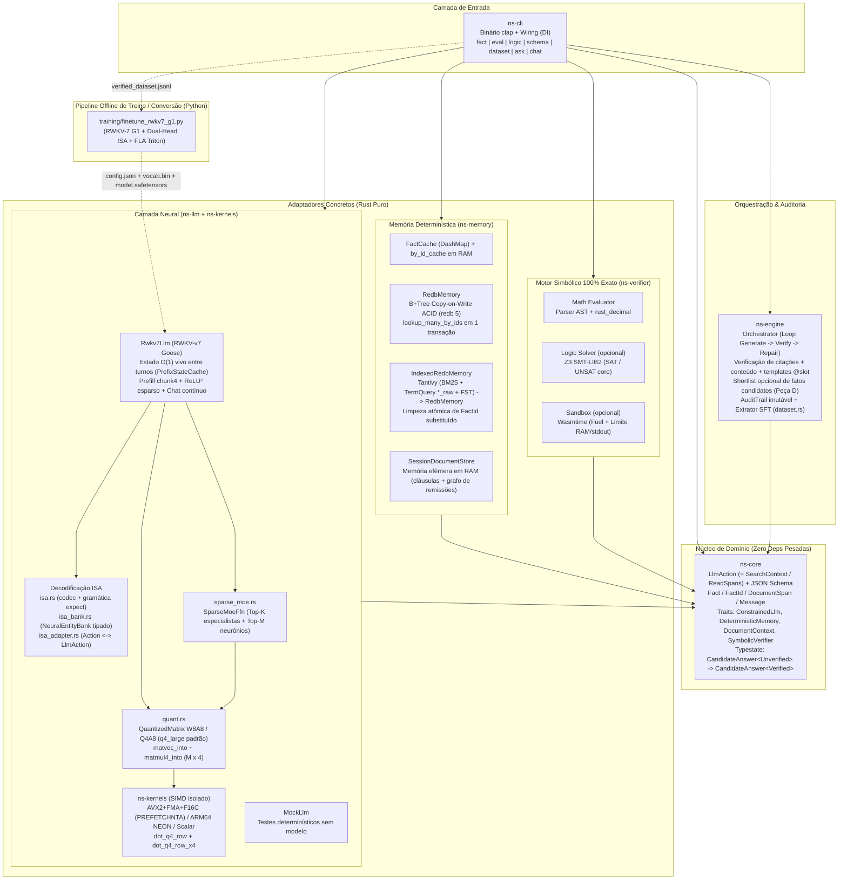
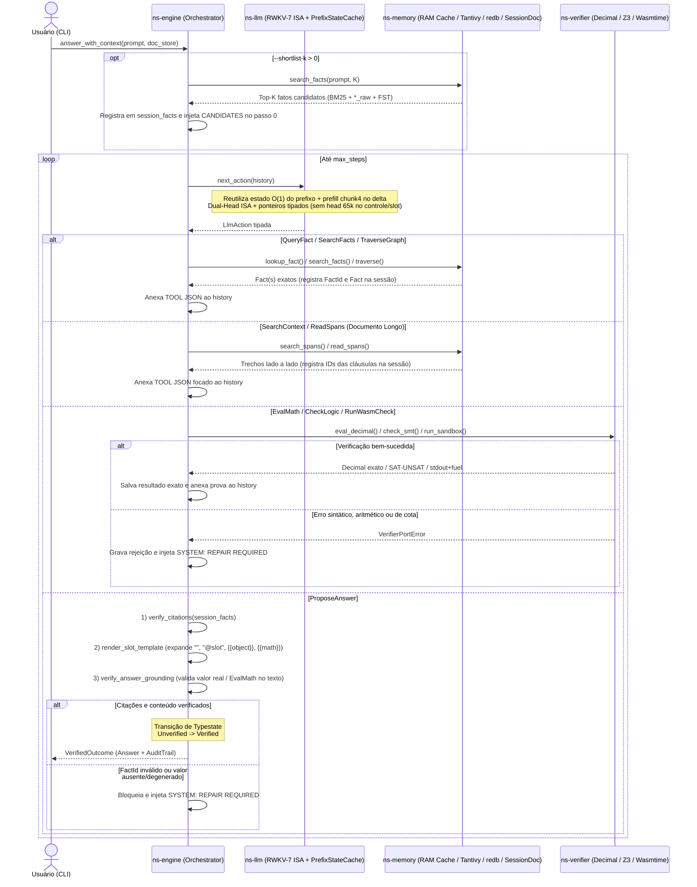
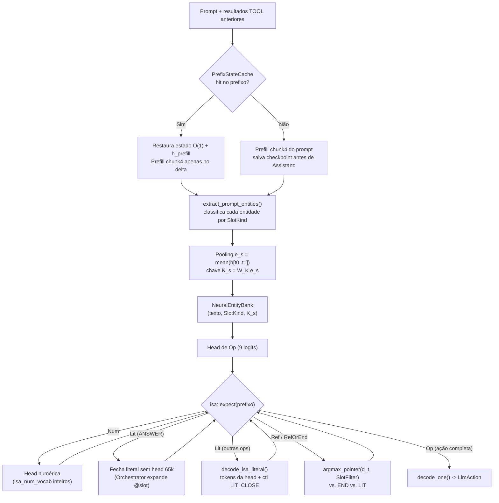
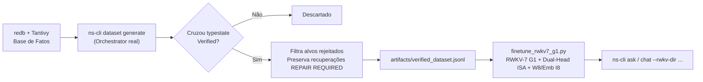
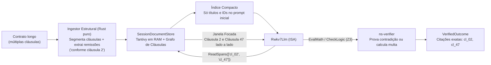

# NeuralSym

Motor **neuro-simbólico em Rust puro** (focado em CPU x86-64/ARM64 e Linux embarcado) que separa a interpretação de linguagem natural (modelo neural RWKV-7 nativo) da verdade factual (memória determinística `redb` + `Tantivy`) e da verificação formal (matemática decimal exata, provas lógicas SMT e execução isolada em WebAssembly).

O sistema dispensa C++/CUDA em tempo de inferência e elimina o KV-Cache crescente dos Transformers tradicionais. Todo o workspace adota `unsafe_code = "forbid"`, isolando apenas os intrínsecos SIMD (`AVX2 + FMA + F16C` e `ARM64 NEON`) no micro-crate dedicado **`ns-kernels`**.

- **RWKV-v7 ("Goose") nativo:** estado matricial $O(1)$ com Regra Delta Generalizada (vivo entre turnos via cache de prefixo), *Value Residual*, prefill em blocos de 4 tokens (`chunk4` com `matmul4_into`), quantização mista `W8A8` / `Q4A8` (`q4_large` padrão), pulo físico de colunas zeradas pelo `ReLU²` na FFN densa, suporte a **`SparseMoeFfn`** (Top-K especialistas + poda Top-M de neurônios) e importação/pós-treino direto do checkpoint aberto **`RWKV-7 G1`** (Apache-2.0).
- **Decodificação 100% ISA (Dual-Head + Entity Pointer):** no modo agente (`ask`), o modelo não gera JSON nem texto livre na `head` de 65k para ações; emite uma sequência curta de símbolos (`Op`, `Ptr`, `Lit`, `Num`, `End`). Entidades (IDs de fatos, cláusulas e termos do prompt) são endereçadas por **ponteiro neural tipado**, tornando **irrepresentável citar um ID inventado** em modo estrito.
- **Templates determinísticos e verificação de conteúdo:** no `ProposeAnswer`, o modelo pode emitir o literal vazio `""` ou `"@slot"` (pulando a `head` de 65k), e o `Orchestrator` materializa a resposta exata a partir dos fatos verificados e/ou `EvalMath`, bloqueando respostas degeneradas ou sem o valor real.

---

## 1. Arquitetura do Sistema

### 1.1 Workspace de Crates e Inversão de Dependência (Ports & Adapters)



### 1.2 Fluxo de Execução (Generate → Verify → Repair)



### 1.3 Decodificação ISA (Dual-Head + Entity Pointer)

O modelo emite sequências curtas de símbolos ISA e o Rust converte de/para `LlmAction` (`isa.rs` + `isa_adapter.rs`). No `ProposeAnswer`, o decodificador fecha o literal diretamente sem chamar a `head` de 65k, delegando a materialização da frase exata ao `render_slot_template` do `Orchestrator`.

| Operação ISA | Forma dos argumentos | `LlmAction` |
|---|---|---|
| `QUERY` | `Ref Ref` | `QueryFact` |
| `SEARCH` | `Ref Num` | `SearchFacts` |
| `TRAVERSE` | `Ref Num` | `TraverseGraph` |
| `EVAL` | `Lit` | `EvalMath` |
| `ANSWER` | `Lit RefList` | `ProposeAnswer` |
| `SEARCH_CTX` | `Ref Num` | `SearchContext` |
| `READ` | `RefList` | `ReadSpans` |
| `LOGIC` | `Lit` | `CheckLogic` |
| `WASM` | `Lit Lit` | `RunWasmCheck` |

Exemplo: `ReadSpans(["cl_02", "cl_47"])` vira `<READ> #0 #1 <END>` e `ProposeAnswer` com fato verificado vira `<ANSWER> "" #5 <END>` (renderizado deterministicamente no `Orchestrator`).



**Entidades tipadas (`SlotKind`).** Cada slot do banco carrega a origem da entidade, e a posição da gramática decide quais origens ficam visíveis ao ponteiro (`SlotFilter`):

| `SlotKind` | Origem | Citável (`ANSWER`) | Legível (`READ`) |
|---|---|:-:|:-:|
| `PromptEntity` | Palavras do `USER:` e campos `subject`/`relation`/`object` | não | não |
| `DocumentToc` | Índice compacto `[cl_02] ...` | não | sim |
| `ReadSpan` | Cláusula já lida via `ReadSpans` (`TOOL: {"spans": ...}`) | sim | sim |
| `VerifiedFact` | Fato retornado por ferramenta (`TOOL: {"fact": ...}`) | sim | não |
| `CandidateFact` | Fato pré-injetado pela shortlist (`CANDIDATES: [...]`) | sim | não |

Com `strict_citations = true`, nas posições de referência só existem ponteiros válidos: um `FactId` inventado, uma entidade só mencionada no prompt ou uma cláusula que não foi lida simplesmente não têm logit. Uma entidade promovida (ex.: `DocumentToc` → `ReadSpan` depois do `READ`) passa a ser citável.

**Propriedades do codec** (cobertas por testes de propriedade em `isa.rs`):

1. `decode(encode(a, bank), bank) == a` para qualquer ação e qualquer banco (o fallback `Lit` torna o codec sem perdas mesmo sem ponteiros).
2. Conversão textual (`to_text` / `from_text`) sem perdas.
3. Um banco de entidades nunca aumenta o custo de decode.
4. `expect()` (a gramática/máscara) nunca proíbe a continuação verdadeira.
5. Nenhuma entrada arbitrária causa `panic`.

### 1.4 Ciclo de Self-Play Verificado e Documentos Longos (Context-as-Memory)





---

## 2. Fórmulas Matemáticas Utilizadas

### 2.1 Confiabilidade Composta (Motivação Neuro-Simbólica)

Em um modelo puramente probabilístico com taxa de acerto $p \in (0,1)$ por passo lógico ou aritmético, a confiabilidade de uma cadeia de $n$ passos decai exponencialmente:

$$P_{\text{puro}}(n) = p^{\,n}$$

Ao delegar consultas factuais ao `ns-memory` e provas/cálculos ao `ns-verifier` ($p_{\text{simbólico}} = 1$), o erro deixa de se acumular nas etapas exatas e fica restrito à tradução de intenção ($k \ll n$ turnos), protegida por até $R$ ciclos de reparo determinístico.

### 2.2 Recorrência RWKV-v7 ("Goose") — Estado Matricial O(1) com Regra Delta Generalizada

Sem KV-Cache: cada camada $\ell$ e cabeça $h \in \{0, \dots, H-1\}$ mantém uma matriz associativa fixa $S_t \in \mathbb{R}^{N \times N}$ ($N = 64$, residente em cache L1) que apaga seletivamente valores antigos sob uma chave normalizada $\tilde{k}_t$ antes de gravar o novo par $(v_t, \hat{k}_t)$:

$$w_t = \exp\!\Big(-e^{-0.5}\,\sigma\big(w_0 + \tanh(x^{(w)}_t W_{w1}) W_{w2}\big)\Big), \qquad a_t = \sigma\big(a_0 + (x^{(a)}_t W_{a1}) W_{a2}\big)$$

$$\tilde{k}_t = \frac{k_t \odot k_k}{\max(\Vert{}k_t \odot k_k\Vert{}_2,\; 10^{-12})}, \qquad \hat{k}_t = k_t \odot \big(1 + (a_t - 1) \odot k_a\big)$$

$$S_t = S_{t-1}\big(\operatorname{diag}(w_t) - \tilde{k}_t (a_t \odot \tilde{k}_t)^\top\big) + v_t \hat{k}_t^\top$$

$$y_t = \operatorname{GroupNorm}_H(S_t\, r_t) + \Big(\sum_{n=0}^{N-1} r_{t,n}\, \hat{k}_{t,n}\, r_{k,n}\Big)\, v_t, \qquad y^{\text{tm}}_t = W_o\, (y_t \odot g_t)$$

Nas camadas $\ell > 0$, o Value Residual mistura o valor da camada 0 ($v^{(0)}_t$) por uma porta aprendível:

$$v_t \leftarrow v_t + \big(v^{(0)}_t - v_t\big) \odot \sigma\big(\nu_0 + (x^{(v)}_t W_{v1}) W_{v2}\big)$$

No prefill em blocos de 4 tokens (`forward_hidden_chunk4`), as projeções lineares são avaliadas em lote via `matmul4_into` ($M \times 4$, lendo cada matriz da RAM uma vez a cada 4 tokens), enquanto o loop WKV7 itera cabeça por fora e $t \in \{0, 1, 2, 3\}$ por dentro para manter $S_t$ quente em L1.

### 2.3 Channel-Mixing RWKV-v7: ReLU² Esparso e *SparseMoeFfn*
Na FFN densa, $W'_v$ é armazenada em layout column-major (SparseColQuantizedMatrix), pulando fisicamente a leitura de todas as colunas zeradas pelo $\operatorname{ReLU}^2$:

$$a^{\text{cm}}_t = \big(\max(0,\; W'_k\, x^{(k')}_t)\big)^2, \qquad y^{\text{cm}}_t = \sum_{\substack{j=0 \\ a^{\text{cm}}_{t,j} > 0}}^{d_{\text{ffn}}-1} a^{\text{cm}}_{t,j}\, W'_{v, :, j}$$

No modo Mixture-of-Experts (`SparseMoeFfn`), um roteador linear seleciona apenas os $\text{top-}k$ especialistas ativos ($\mathcal{E}_k$), normalizados via $\operatorname{softmax}$, combinando esparsidade de especialistas com poda opcional $\text{top-}M$ de neurônios ativos por especialista:

$$y^{\text{moe}}_t = \sum_{e \in \mathcal{E}_k} \alpha_e \sum_{j \in \mathcal{A}_e} a^{(e)}_{t,j}\, W'^{(e)}_{v, :, j}, \qquad \alpha_e = \frac{\exp(r_e)}{\sum_{m \in \mathcal{E}_k} \exp(r_m)}$$

### 2.4 Quantização Mista W8A8 e Q4A8 (Bloco de 32 com SIMD)
- W8A8 (por linha, padrão para LoRAs e projeções menores):

 $$s_i = \frac{\max_{0 \le j < K} \vert{}W_{i,j}\vert{}}{127}, \qquad Q_{i,j} = \operatorname{clamp}\!\left(\operatorname{round}\!\left(\frac{W_{i,j}}{s_i}\right),\, -127,\, 127\right)$$

$$\hat{y}_i = (s_i \cdot s_x) \sum_{j=0}^{K-1} \operatorname{i32}(Q_{i,j}) \cdot \operatorname{i32}(q_{x,j})$$

  Garantia de ausência de overflow em 32 bits: para qualquer $K \le 131\,072$ (`MAX_QUANT_IN_DIM`), $127^2 \cdot K \le 2\,114\,060\,288 \le 2^{31}-1$.

- Q4A8 (por bloco de $B = 32$ pesos, padrão `q4_large` para matrizes com $\ge 10^6$ pesos): cada bloco armazena uma escala `f16` ($s_{w,b}$) e 16 bytes com nibbles split-half deslocados em $+8$ ($u_{b,j} \in \{0, \dots, 15\}$):

$$\hat{y}_i = \sum_{b=0}^{\lceil K/32 \rceil - 1} s_{w,b} \left( s_{x,b} \sum_{j=0}^{31} u_{b,j}\, q_{x,b,j} - 8\, s_{x,b} \sum_{j=0}^{31} q_{x,b,j} \right)$$

  O kernel SIMD em ns-kernels executa tanto o produto escalar unitário quanto o micro-matmul $M \times 4$ (descompactando cada bloco Q4 uma única vez para 4 vetores de entrada).

### 2.5 Ranqueamento Híbrido no Tantivy (BM25 + *_raw + FST)
Na busca de IndexedRedbMemory e da Shortlist (Peça D), o TantivyFactIndex combina BM25 sobre campos tokenizados (com remoção de stopwords/pontuação), TermQuery exato nos campos *_raw (preservando identificadores com _, -, %) e fallback regex sobre a FST:

$$\text{BM25}(D, Q) = \sum_{q \in Q} \text{IDF}(q) \cdot \frac{f(q, D) \cdot (k_1 + 1)}{f(q, D) + k_1 \cdot \left(1 - b + b \cdot \frac{\vert{}D\vert{}}{\text{avgdl}}\right)}$$

### 2.6 Ponteiro de Entidade da ISA e Custo de Decode
Para cada entidade $s$ do prompt, ocupando os tokens $[t_0, t_1)$, a chave do ponteiro vem do pooling dos estados ocultos do prefill. Em cada posição de referência, a query vem do estado atual e o slot é o de maior score entre os permitidos pelo filtro $\mathcal{F}$ da gramática:

$$e_s = \frac{1}{t_1 - t_0} \sum_{t=t_0}^{t_1 - 1} h_t, \qquad K_s = W_K\, e_s, \qquad q_t = W_Q\, h_t$$

$$\hat{s} = \operatorname*{arg\,max}_{s \,\in\, \mathcal{F}(\text{op},\, \text{kind})} \frac{q_t^\top K_s}{\sqrt{d_p}}, \qquad d_p = \texttt{isa\_ptr\_dim}$$

O símbolo emitido é o de maior score entre o melhor ponteiro, `END` (só em `RefOrEnd`) e `LIT_OPEN` (só quando o literal é permitido; em modo estrito ele é proibido nas posições de citação).

O custo de uma ação, em passos de decode, é a soma dos custos de cada símbolo:

$$\text{custo}(\sigma_1 \dots \sigma_m) = \sum_{i=1}^{m} c(\sigma_i), \qquad c(\sigma) = \begin{cases} \lvert \text{tokens}(\text{texto}) \rvert + 1 & \sigma = \texttt{Lit}(\text{texto}) \\ 1 & \text{caso contrário (Op, Ptr, Num, End)} \end{cases}$$

---

## 3. Estrutura do Workspace e Features

```text
neuralsym/
├── Cargo.toml                           # Virtual workspace (edition 2024, MSRV 1.95)
├── README.md
├── artifacts/                           # Datasets, checkpoints e bancos gerados (não versionado)
├── training/
│   ├── finetune_rwkv7_g1.py             # Conversor + SFT RWKV-7 G1 (Dual-Head ISA + W8/Emb I8 + FLA)
│   └── rwkv7_block.py                   # Bloco RWKV-7 modular para PyTorch / Triton
└── crates/
    ├── ns-core/                         # LlmAction, Fact, DocumentSpan, traits (ports), erros tipados, typestate
    │   └── src/                         # action, error, fact, ports, verification
    ├── ns-kernels/                      # Micro-crate SIMD isolado (AVX2+FMA+F16C, ARM64 NEON, scalar) para Q4 / M x 4
    │   └── src/lib.rs
    ├── ns-memory/                       # RedbMemory (redb 5 + RAM cache), IndexedRedbMemory (Tantivy), SessionDocumentStore
    │   ├── src/                         # facts, search/tantivy_index.rs, store/redb.rs, session_doc.rs
    │   └── benches/                     # storage_comparison.rs
    ├── ns-llm/                          # Motor neural nativo 100% ISA + Chat
    │   ├── src/
    │   │   ├── rwkv7.rs                 # Rwkv7Llm, PrefixStateCache, prefill chunk4, ISA, chat contínuo
    │   │   ├── quant.rs                 # QuantizedMatrix W8A8/Q4A8 (matvec_into, matmul4_into, argmax_rows)
    │   │   ├── sparse_moe.rs            # SparseMoeFfn (Top-K especialistas + poda Top-M neurônios)
    │   │   ├── isa.rs                   # Codec Action <-> ISA + gramática expect() (só std)
    │   │   ├── isa_bank.rs              # NeuralEntityBank, SlotKind, SlotFilter, extração de entidades
    │   │   ├── isa_adapter.rs           # Conversões ISA <-> ns_core::LlmAction
    │   │   ├── chat.rs                  # Sessão de chat, amostragem (temperature / top-p / presence)
    │   │   ├── grammar.rs               # JSON Schema de LlmAction (exportação via `ns-cli schema`)
    │   │   ├── mock.rs                  # MockLlm
    │   │   └── error.rs
    │   ├── benches/rwkv_speed.rs        # Benchmark de CPU (prefill seq vs chunk4, hidden, head, E2E ISA)
    │   └── examples/                    # q4_vs_w8_bench, matmul4_bench, moe_constant_latency, isa_measure, isa_compression
    ├── ns-verifier/                     # rust_decimal AST (math), Z3 (logic), Wasmtime (sandbox)
    ├── ns-engine/                       # Orchestrator (citações + conteúdo + @slot), AuditTrail, extrator SFT
    │   ├── src/                         # orchestrator, audit, dataset, error
    │   └── tests/                       # grounding_and_templates, document_context_audit, shortlist_retrieval, ...
    └── ns-cli/                          # Binário CLI (fact, eval, logic, schema, dataset, ask, chat)
        ├── src/                         # lib (clap), backend, config, dataset_gen
        └── tests/
```

**Features de Cargo relevantes:**

| Feature | Efeito |
|---|---|
| `custom-rwkv` | Habilita o motor `Rwkv7Llm` no `ns-cli` (`--rwkv-dir`, `chat`) e o benchmark do `ns-llm`. Sem ela, esses comandos retornam erro pedindo o rebuild. |
| `wasm-sandbox` | Habilita o `RunWasmCheck` via Wasmtime (fuel + limites de RAM/stdout). |
| `z3-solver` / `z3-static` | Habilita `CheckLogic` e o subcomando `logic` (SMT-LIB2). |

---

**Variáveis de ambiente de quantização (NS_WEIGHT_QUANT):**

| Valor | Comportamento |
|-----|-----|
| (padrão) ou `q4_large` | Q4 SIMD em matrizes $\ge 10^6$ pesos (`cm.key`, `head`, projeções de modelos 1.5B+); LoRAs e Time-Mixing 0.1B em W8.
| `q4` | Q4 SIMD em matrizes $\ge 512\text{k}$ pesos; LoRAs pequenos permanecem em W8.
| `q4_all` | Força Q4 SIMD em todas as matrizes.
| `w8` | Força W8A8 em todas as matrizes.

## 4. Pré-requisitos por Perfil de Uso

### Perfil 1 — NeuroSym Completo (RWKV-7 + redb + Tantivy + Wasmtime, 100% Rust puro)

- Rust 1.100+ (`rustup update stable`)

### Perfil 2 — Conversão / Pós-Treino SFT em PyTorch (`training/`)

- Python 3.10+

```bash
python3 -m venv .venv
source .venv/bin/activate
pip install torch safetensors tokenizers
# Opcional em GPU NVIDIA Linux para kernel Triton paralelo por chunks (RWKV-7):
pip install flash-linear-attention
```

### Perfil 3 — Validação Lógica com Z3 (`--features z3-solver` ou `--features z3-static`)

- LLVM/Clang instalado e `LIBCLANG_PATH` definido (veja a seção 6).

---

## 5. Como Compilar, Testar e Rodar em Qualquer Máquina

### 5.1 Validar o workspace e benchmarks de CPU

```bash
# Suíte de testes e Clippy
cargo test --workspace
cargo test -p ns-kernels
cargo test -p ns-llm --features custom-rwkv
cargo test -p ns-memory --all-features
cargo clippy --workspace --all-targets

# Verificadores opcionais (Wasmtime e Z3)
cargo test -p ns-verifier -p ns-cli --features wasm-sandbox
CMAKE_POLICY_VERSION_MINIMUM=3.5 cargo test -p ns-verifier -p ns-cli --features z3-solver

# Benchmark de CPU (prefill seq vs chunk4, hidden, head completa/esparsa e E2E ISA)
RAYON_NUM_THREADS=6 RUSTFLAGS="-C target-cpu=native" \
  cargo bench -p ns-llm --features custom-rwkv --bench rwkv_speed

# O mesmo benchmark sobre um checkpoint real
RAYON_NUM_THREADS=6 NS_RWKV_BENCH_DIR=artifacts/rwkv7_g1_01b_isa \
  RUSTFLAGS="-C target-cpu=native" \
  cargo bench -p ns-llm --features custom-rwkv --bench rwkv_speed

# Micro-benchmarks de quantização, micro-matmul M x 4 e escala MoE
RAYON_NUM_THREADS=6 RUSTFLAGS="-C target-cpu=native" \
  cargo run --release -p ns-llm --features custom-rwkv --example q4_vs_w8_bench
RAYON_NUM_THREADS=6 RUSTFLAGS="-C target-cpu=native" \
  cargo run --release -p ns-llm --features custom-rwkv --example matmul4_bench
RAYON_NUM_THREADS=6 RUSTFLAGS="-C target-cpu=native" \
  cargo run --release -p ns-llm --features custom-rwkv --example moe_constant_latency
```

O benchmark reporta, para cada etapa (prefill, `forward_hidden`, head completa, head esparsa de 256 e 32 linhas, decode denso e decode guiado por `llguidance`), média, p50, p99 e tok/s, além da esparsidade ReLU² e da memória extra do Copy Gate.

### 5.2 Fluxo Principal — RWKV-7 G1 (Chat + Agente ISA Verificado)

```bash
# 1. Baixar checkpoint oficial RWKV-7 G1 (Apache-2.0) e vocabulário World
mkdir -p artifacts/pretrained
curl -L -o artifacts/pretrained/rwkv7-g1d-0.1b-20260129-ctx8192.pth \
  "[https://huggingface.co/BlinkDL/rwkv7-g1/resolve/main/rwkv7-g1d-0.1b-20260129-ctx8192.pth](https://huggingface.co/BlinkDL/rwkv7-g1/resolve/main/rwkv7-g1d-0.1b-20260129-ctx8192.pth)"
curl -L -o artifacts/pretrained/rwkv_vocab_v20230424.txt \
  "[https://huggingface.co/fla-hub/rwkv7-0.1B-g1/resolve/main/rwkv_vocab_v20230424.txt](https://huggingface.co/fla-hub/rwkv7-0.1B-g1/resolve/main/rwkv_vocab_v20230424.txt)"

# 2. Conversão rápida para conversar imediatamente via `ns-cli chat`
source .venv/bin/activate
python training/finetune_rwkv7_g1.py \
  --pth artifacts/pretrained/rwkv7-g1d-0.1b-20260129-ctx8192.pth \
  --vocab-txt artifacts/pretrained/rwkv_vocab_v20230424.txt \
  --out-dir artifacts/rwkv7_g1_01b_base \
  --convert-only \
  --quantize-int8 \
  --quantize-emb-int8

# 3. Conversa contínua no terminal (estado matricial O(1) vivo entre turnos)
RAYON_NUM_THREADS=6 RUSTFLAGS="-C target-cpu=native" cargo run --release -p ns-cli -- \
  chat --rwkv-dir artifacts/rwkv7_g1_01b_base --temperature 0.7 --top-p 0.85
# Comandos dentro do chat: /reset (nova conversa), /stats (estado), /exit (sair)
# Use --no-think para pular o bloco <think> do RWKV-7 G1

# 4. Gerar dataset verificado e treinar a Dual-Head ISA
cargo run --release -p ns-cli -- --backend indexed-redb \
  --db-path artifacts/train.redb \
  dataset generate --seed-synthetic 80 --output artifacts/verified_dataset.jsonl

python training/finetune_rwkv7_g1.py \
  --pth artifacts/pretrained/rwkv7-g1d-0.1b-20260129-ctx8192.pth \
  --vocab-txt artifacts/pretrained/rwkv_vocab_v20230424.txt \
  --dataset artifacts/verified_dataset.jsonl \
  --out-dir artifacts/rwkv7_g1_01b_isa \
  --isa-ptr-dim 64 \
  --train-last-layers 0 \
  --freeze-head \
  --quantize-int8 \
  --quantize-emb-int8

# 5. Rodar o RWKV-7 ISA no Orchestrator verificado (q4_large + chunk4 + estado vivo ativos por padrão)
RAYON_NUM_THREADS=6 RUST_LOG=ns_llm=debug RUSTFLAGS="-C target-cpu=native" \
  cargo run --release -p ns-cli -- \
  --backend indexed-redb \
  --db-path artifacts/eval_inedito.redb \
  ask \
  --rwkv-dir artifacts/rwkv7_g1_01b_isa \
  --prompt "Qual o(a) preco_mensal de plano_enterprise?" \
  --require-citations \
  --show-audit
```

### 5.3 Shortlist de Candidatos (Peça D) e Medição da ISA

```bash
# --shortlist-k K pré-injeta os top-K fatos do Tantivy (CANDIDATES: [...]) antes do passo 0
RAYON_NUM_THREADS=6 RUST_LOG=ns_llm=debug RUSTFLAGS="-C target-cpu=native" \
  cargo run --release -p ns-cli -- \
  --backend indexed-redb \
  --db-path artifacts/eval_inedito.redb \
  ask \
  --rwkv-dir artifacts/rwkv7_g1_01b_isa \
  --shortlist-k 12 \
  --prompt "Qual o(a) preco_mensal de plano_enterprise?" \
  --require-citations \
  --show-audit

# Medir compressão e propriedades do codec ISA
cargo run --release -p ns-llm --features custom-rwkv --example isa_measure
cargo run --release -p ns-llm --features custom-rwkv --example isa_compression
```

### 5.4 Outros comandos úteis do CLI

```bash
# Fatos e índice invertido Tantivy (padrão: indexed-redb)
cargo run -p ns-cli -- fact add --id f1 --subject plano_pro --relation preco_mensal --object 199.90
cargo run -p ns-cli -- fact get --entity plano_pro --relation preco_mensal
cargo run -p ns-cli -- fact search --query "plano_"
cargo run -p ns-cli -- fact traverse --start plano_pro --max-hops 2
cargo run -p ns-cli -- fact rebuild-index

# Dataset verificado sem os cenários de erro + recuperação REPAIR REQUIRED
cargo run --release -p ns-cli -- dataset generate --seed-synthetic 80 --no-repairs

# Auditoria de documento longo indexado em RAM
RAYON_NUM_THREADS=6 RUSTFLAGS="-C target-cpu=native" cargo run --release -p ns-cli -- ask \
  --rwkv-dir artifacts/rwkv7_g1_01b_isa \
  --context-file contrato.txt \
  --prompt "Existe conflito entre o prazo da cláusula 2 e a cláusula 47?" \
  --require-citations \
  --show-audit

# Simular o LLM sem modelo (testes determinísticos com MockLlm)
cargo run -p ns-cli -- ask --prompt "teste" --actions-json '[...]'

# JSON Schema de LlmAction
cargo run -p ns-cli -- schema

# Aritmética decimal exata e provas formais com Z3
cargo run -p ns-cli -- eval "(199.90 * 3) * (1 + 0.15)"
CMAKE_POLICY_VERSION_MINIMUM=3.5 cargo run -p ns-cli --features z3-solver -- logic --script "
  (declare-const desconto Real)
  (assert (! (<= desconto 0.30) :named limite_politica))
  (assert (! (= desconto 0.45) :named desconto_proposto))
"
```

- `--shortlist-k K` pré-injeta `K` fatos candidatos (`CANDIDATES: [...]`) antes do passo 0. No modo ISA eles entram no banco como `CandidateFact` (citáveis). `0` desativa. A trilha de auditoria mostra a shortlist usada.
- Outros limites do `ask`: `--max-steps` (padrão 6, loop Generate → Verify → Repair) e `--max-tokens` (padrão 512 por ação).
- Com `RUST_LOG=ns_llm=debug`, o modo ISA registra a ação em texto (ex.: `<READ> #0 #1 <END>`), o número de símbolos e de slots do banco.

Para comparar JSON e ISA e medir a compressão de passos de decode:

```bash
cargo run --release -p ns-llm --features custom-rwkv --example isa_measure
cargo run --release -p ns-llm --features custom-rwkv --example isa_compression
cargo run --release -p ns-cli --features custom-rwkv --example eval_json_vs_isa
```

---

## 6. Solução de Problemas Comuns

- **Erro de MSRV ao compilar:** rode `rustup update stable` para garantir Rust 1.95+ (Edition 2024).
- **Latência alta no RWKV em debug:** sempre rode `ask`, `chat` e `bench` com `--release` e `RUSTFLAGS="-C target-cpu=native"` (habilita AVX2/NEON na auto-vetorização de `dot_i8_unrolled`, acelerando 20x–40x em relação a debug).
- **`compiled without the 'custom-rwkv' feature`:** o `ns-cli` foi compilado sem o motor RWKV-7. Recompile com `--features custom-rwkv`.
- **`checkpoint does not contain isa head weights (isa_ptr_dim == 0)`:** você usou `--mode isa` com um checkpoint sem a Dual-Head ISA. Use `--mode auto` (ou `json`) ou um checkpoint com `isa_ptr_dim > 0` no `config.json`.
- **Qual backend de memória escolher?** `indexed-redb` é o padrão recomendado (Tantivy para busca BM25/FST + redb como fonte ACID); use `--backend redb` em embarcados ultracompactos quando não precisar de busca textual.
- **`Unable to find libclang`:** ocorre apenas ao ativar `--features z3-solver`; instale LLVM/Clang e defina `LIBCLANG_PATH`.
